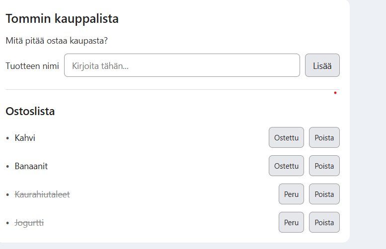
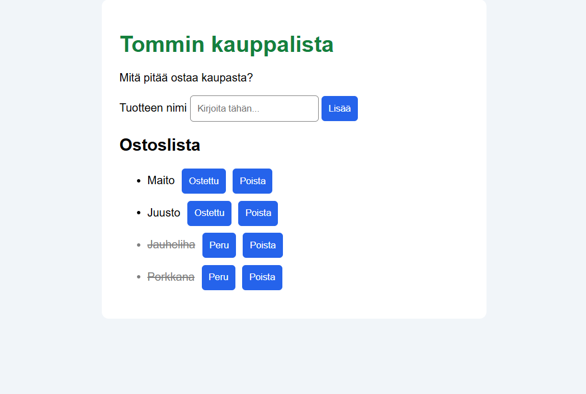

Projektin nimi: Tommin kauppalista Tekijä: Tommi Lehtimäki

Projektisuunnitelma
Projektin ideana on tehdä toimiva kauppalistasovellus, johon voi kirjata kaupasta ostettavia asioita, merkata ne ostetuksi sekä poistaa listasta. 

Suunnitellut toiminnot:
1. listata ostettavia asioita
2. merkata ostetuksi
3. poistaa listalta

Rautalankamalli

Verkkolinkit
Linkki sovellukseen: https://tommilehtimaki.github.io/laurea-web-development-1-HTML-CSS/WS1_project/
Linkki demovideoon: https://youtu.be/M4VgvQCH90A
Linkki GitHub repositorioon: https://github.com/tommilehtimaki/laurea-web-development-1-HTML-CSS

Tietoja sovelluksesta
Tommin kauppalista on sovellus, jonka tarkoituksena on helpottaa ihmistä muistamaan asioita, joita ostaa kaupasta. Sovelluksen on tarkoitus olla helppokäyttöinen kaikille ja vaiheita on hyvin vähän. Tärkeimmät toiminnot ovat tuotteiden listaus, tuotteiden kuittaaminen ostetuksi sekä niiden poistaminen listalta.

Käytetyt teknologiat
HTML:n rooli tässä projektissa on sivuston rakenne. CSS:ää käytin tyylimuutoksiin, Javascript hoiti sovelluksen toiminnallisuuden.

Sovelluksen käyttö
1. syötä tekstikenttään ostettavia asioita ja paina lisää
2. kun tuote on ostettu, paina ostettu näppäintä tai, jos haluat poistaa tuotteen listalta, paina poista näppäintä.
3. kun olet kuitannut tuotteen ostetuksi ja haluat perua kuittauksen, paina peru näppäintä

Kuvakaappaus toimivasta sovelluksesta:

Tunnetut virheet/puutteet
Ei tunnettuja virheitä tai puutteita

Oman työn reflektointi

Missä onnistuin?

Onnistuin saamaan aikaan yksinkertaisen kauppalistasovelluksen, jossa käyttäjä voi lisätä tuotteita, merkitä niitä ostetuiksi ja poistaa niitä listasta. Olen tyytyväinen siihen, että sovellus on selkeä eikä siinä ole turhia ominaisuuksia. Onnistuin myös perehtymään koodin toimintaan ja ymmärtämään paremmin, miten sovelluksen eri osat liittyvät toisiinsa.

Mikä oli haastavaa?

Suurin haaste oli JavaScript. Yksittäisten komentojen ymmärtäminen onnistui selitysten avulla, mutta niiden yhdistäminen toimivaksi kokonaisuudeksi oli vaikeaa. Erityisesti JavaScript-koodin kirjoittaminen itsenäisesti tuntui haastavalta. Tarvitsin toteutuksessa paljon tekoälyn apua ja käytin useita tunteja koodin toiminnan opiskeluun.

Mitä parantaisin, jos aikaa olisi enemmän?

Jos aikaa olisi enemmän, harjoittelisin JavaScriptin kirjoittamista itsenäisemmin ja yrittäisin toteuttaa enemmän toimintoja itse. Voisin myös kehittää sovelluksen ulkoasua ja lisätä uusia ominaisuuksia, kuten tuotteiden tallentamisen niin, että ne säilyisivät sivun päivittämisen jälkeen.

Mitä opin HTML:stä, CSS:stä, JavaScriptistä ja DOM-skriptauksesta?

HTML:n avulla rakennetaan verkkosivun rakenne, kuten otsikot, tekstikentät ja painikkeet. CSS:llä voidaan muokata esimerkiksi värejä, fontteja ja elementtien ulkoasua.

JavaScriptistä opin erityisesti sen, miten käyttäjän toimintoihin voidaan reagoida. DOM-skriptauksen avulla JavaScript pystyy käsittelemään HTML-elementtejä. Opin esimerkiksi, että `getElementById()` hakee elementin, `createElement()` luo uuden elementin ja `appendChild()` lisää sen sivun rakenteeseen. Opin myös paremmin, miten ehtolauseilla voidaan tarkistaa käyttäjän syöttämiä tietoja.

Mikä jäi epäselväksi tai mistä haluaisin oppia lisää?

Haluaisin oppia erityisesti JavaScript-koodin kirjoittamista ilman valmiita esimerkkejä. Ymmärrän jo joidenkin komentojen tarkoituksen, mutta minun on edelleen vaikea tietää, mitä komentoja missäkin tilanteessa pitäisi käyttää. Haluaisin myös oppia lisää tapahtumankäsittelystä ja DOM-skriptauksesta.

Oma arvio projektista: 7/10 pistettä

Mielestäni sovellus onnistui toiminnallisesti hyvin ja täyttää tehtävän keskeiset vaatimukset. En kuitenkaan anna itselleni korkeampia pisteitä, koska tarvitsin koodin toteuttamiseen paljon ulkopuolista apua. Olen silti tyytyväinen siihen, että käytin aikaa projektin ymmärtämiseen ja opin sen aikana uusia asioita.

Lähteet ja tekoälyn käyttö

Käytetty tekoälytyökalu: OpenAI ChatGPT

Miten työkalua käytettiin:

Käytin ChatGPT:tä projektissa erityisesti JavaScript-koodin toteuttamiseen. Tekoäly tuotti suurimman osan sovelluksen koodista ja auttoi sen yksinkertaistamisessa omaan osaamistasooni sopivammaksi.

Käytin ChatGPT:tä myös ohjelmoinnin käsitteiden opetteluun ja koodin toiminnan ymmärtämiseen. Harjoittelin sen avulla esimerkiksi DOM-skriptausta, tapahtumankäsittelyä, ehtolauseita sekä tuotteiden lisäämistä ja poistamista kauppalistasta.

Tekoäly oli merkittävä apu projektin toteutuksessa, sillä JavaScript-koodin kirjoittaminen itsenäisesti oli minulle haastavaa. Käytin aikaa myös koodin tutkimiseen ja sen toiminnan ymmärtämiseen.

Muut lähteet:

Projektissa ei käytetty ulkopuolisia kuvia tai erillisiä verkkotutoriaaleja.

Kauppalistasovellus julkaistaan GitHub Pagesissa.

